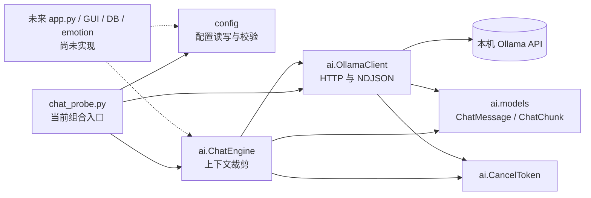
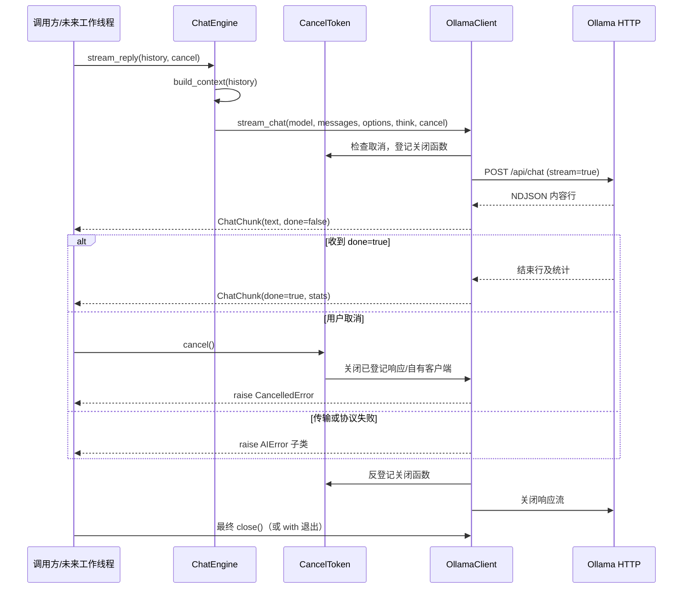

# Stage 2 AI 核心交付检查

检查日期：2026-10-23。范围：Stage 1 配置合并状态、Stage 2 AI 核心及其离线测试；本报告供独立 AI 架构审查使用。本文区分**当前代码**与后续阶段的设计，不能替代独立审查或 GUI 验收。

## 1. 当前项目架构

当前可执行的主路径是 `scripts/chat_probe.py` → 配置层与 AI 层。`emowall/storage`、`emowall/emotion`、`emowall/gui` 目前只有包骨架；`emowall/app.py` 尚不存在。`docs/ARCHITECTURE.md` 中的 GUI、数据库线程和情绪流程是后续阶段设计，当前没有实现。

`ai` 与 `config` 均为叶子层，互不导入；AI 层仅使用标准库与 `httpx`，没有 Qt、SQLite 或 `asyncio`。`ChatEngine` 负责上下文和请求参数，`OllamaClient` 负责 Ollama 协议，调用方负责会话历史、生成器消费和资源关闭。

## 2. Stage 1 合并状态

- Git 分支为 `feature/stage2-ai-core`；Stage 1 提交 `6da908b` 是审查基线 Stage 2 提交 `0cccac2` 的祖先。检查开始时 `git status --short --branch` 无未提交修改，`git ls-files -u` 无冲突条目。
- `ConfigStore`、`AppSettings`、`OllamaSettings`、`ChatSettings` 均在当前树中。代码实现缺失文件时生成默认配置、读取和保存往返、损坏文件先备份再恢复、非法字段单独回退、未知字段保存时保留、同目录临时文件加 `os.replace` 原子替换。
- `tests/test_config.py` 与 `tests/test_ai_config.py` 验证上述行为、配置参数注入 AI、更新配置后创建新客户端、两层不互相导入。架构守护测试同时检查依赖方向。
- 本次检查发现非法配置值曾直接写入 warning 日志。已把日志改为只记录字段名及回退动作，并增加不泄露输入值的回归测试；配置文件和公开接口未改变。

## 3. Stage 2 已实现功能

同步 Ollama `/api/version`、`/api/tags` 和 `/api/chat` 流式调用；NDJSON 增量解析与结束统计；按轮次和条数/字符预算裁剪上下文；跨线程取消令牌；连接、超时、HTTP、模型缺失、协议、断流、取消的异常分类；离线 MockTransport/假客户端测试与可选真实 Ollama 联调测试。

实现只支持一个 Ollama 提供者和文本消息。模型名称可通过创建新 `ChatEngine` 切换，但没有通用提供者协议、注册表或独立的多提供者配置。

## 4. 核心模块及职责

| 模块 | 当前职责 | 生命周期/边界 |
| --- | --- | --- |
| `emowall/config/{settings,store,paths}.py` | 默认值、校验、配置路径、JSON 读写与恢复 | 不导入 AI，不发网络请求 |
| `emowall/ai/models.py` | 不可变 `ChatMessage`、`ChatChunk`、`GenerationStats` | 文本角色限 system/user/assistant |
| `emowall/ai/engine.py` | 无状态历史裁剪、系统提示、调用 `stream_chat` | 历史由调用方按会话传入，不持久化 |
| `emowall/ai/client.py` | Ollama HTTP、NDJSON、状态码及异常映射 | 自建 `httpx.Client` 需显式 `close()` 或 `with`；注入客户端由注入者关闭 |
| `emowall/ai/cancel.py` | 跨线程取消标志与活动资源关闭登记 | 每轮使用新令牌；复用时须确认旧生成已结束 |
| `emowall/ai/errors.py` | `AIError` 异常层级 | 调用方可统一捕获基类或按子类处理 |
| `scripts/chat_probe.py` | 当前配置与 AI 的实际装配、多轮命令行探针 | 无 GUI/DB；脚本负责保存内存历史及关闭客户端 |

## 5. 主要调用流程

`ConfigStore.load()` 取得配置 → 入口映射配置字段并构造 `OllamaClient` 与 `ChatEngine` → 调用方把本会话历史及新用户消息传给 `stream_reply()` → `build_context()` 保留 system 和最新轮次，按预算裁去较旧轮次 → `OllamaClient.stream_chat()` 发出 Ollama 请求 → `ChatChunk` 逐块返回 → 调用方拼接完整或部分回复并决定是否写回历史。当前探针在正常结束后把回复加入内存历史；数据库持久化与 GUI 状态恢复尚无实现。

## 6. AI 请求生命周期与核心事件流程

生成器开始迭代才发请求；消费者提前停止时必须显式关闭生成器。正常、异常和取消路径均通过响应 `with` 块释放流。自有客户端在等待响应头时可被取消关闭，下次请求按需重建；注入的 HTTP 客户端由外部管理，其等待响应头取消能力需要另行审查。

目前流式 API 只有**内容**和**结束**两种 `ChatChunk` 形态。开始、错误、取消通过调用开始和异常表达，没有独立事件对象或订阅机制；未来 GUI 需由工作线程把块和异常映射成 UI 信号，尚未验证。

## 7. 关键接口

| 接口 | 用途与约定 |
| --- | --- |
| `ConfigStore.load() -> AppSettings` / `save(settings) -> None` | 加载兼容配置、原子保存；单实例不是并发配置事务 |
| `ChatEngine.build_context(history) -> list[ChatMessage]` | 不修改原历史；system 与最新轮次为硬底线 |
| `ChatEngine.stream_reply(history, *, cancel=None) -> Iterator[ChatChunk]` | 同步阻塞生成器；调用方传入本会话历史 |
| `OllamaClient.stream_chat(*, model, messages, options=None, think=False, cancel=None)` | Ollama 传输入口，返回增量块及 done 块 |
| `CancelToken.cancel()` / `raise_if_cancelled()` | 跨线程发起取消及识别取消状态 |
| `OllamaClient.close()` / 上下文管理器 | 关闭自有 HTTP 客户端；注入客户端由注入者关闭 |
| `AIError` 子类 | 连接、超时、HTTP（含状态码）、模型缺失、协议、断流、取消分类 |

HTTP 401 等认证错误目前归入 `OllamaHTTPError(status_code=401)`，没有认证专属异常。模型切换只换 `ChatEngine(model=...)`；切换提供者仍需新增适配器并修改当前具体类型依赖。

## 8. 已运行测试与结果

| 命令/检查 | 本次实际结果 | 说明 |
| --- | --- | --- |
| `.venv\Scripts\python.exe -m pytest`（沙箱内首次） | **1 failed, 210 passed, 1 skipped, 8 deselected** | `test_http_json_rejects_non_json_payload` 本机回环连接遭 Windows `WinError 10013`；没有把失败当作通过 |
| 同一命令（允许本机回环连接后，日志修复与新增测试完成后） | **215 passed, 1 skipped, 8 deselected** | 最终完整默认测试通过；初次成功重跑为 211 passed、1 skipped、8 deselected |
| `.venv\Scripts\python.exe -m pytest -m "not integration and not local_network"` | **213 passed, 1 skipped, 10 deselected** | 沙箱内无真实 socket 的最终离线子集 |
| `.venv\Scripts\python.exe -m pytest -m integration` | **1 passed, 7 skipped, 216 deselected** | 本次 Ollama 服务不可用；1 项无需服务，7 项由测试夹具跳过。阶段规划记录的历史 `8 passed` 未在本次复现 |
| `git merge-base --is-ancestor 6da908b HEAD` | 退出码 0 | Stage 1 提交确在当前 Stage 2 分支历史中 |
| `git ls-files -u` / 初始 `git status` | 无输出/干净 | 开始检查时无冲突、无未提交修改 |

覆盖点包括配置往返与兼容、非法配置值日志保护、60 条历史裁剪、流式分块与 done、取消及后续请求、连接与读取超时、401/403/404/500、断流、协议错误、响应关闭、Qt 导入守护。`tests/conftest.py` 默认拦截真实 socket，`local_network` 与 `integration` 标记除外。测试通过证明了已覆盖路径，不等同于真实网络与 GUI 的完整验收。

## 9. 已知问题

1. **扩展契约未统一**：`ChatEngine` 构造参数标注为具体 `OllamaClient`；其他提供者可模拟 `stream_chat`，但尚无显式 `Protocol`/提供者接口，错误类型也带 Ollama 命名。独立多提供者配置未实现。
2. **事件种类不足**：`ChatChunk` 仅有文本、done、统计。开始、错误、取消不是流事件；工具调用、思考内容、音视频块也没有表示。订阅与 UI 信号转换未实现。
3. **上下文预算是近似值**：只按字符与消息数裁剪；system 和最新轮次即使超预算也保留，因此可能超过模型真实 token 窗口。历史归属和保存由调用方负责。
4. **单路生成约束**：同一自有客户端被取消时会关闭底层 `httpx.Client`；若并发复用，可能影响其他请求。`CancelToken.reset()` 的“旧生成已结束”前提由调用方保证。
5. **服务依赖的本次验收缺口**：真实 Ollama 7 项用例本次跳过；GUI、部分回复持久化和取消后的输入恢复无代码可测。

## 10. 尚未验证的风险

- 冷启动、响应头前取消在真实服务上的时延与跨线程关闭行为，本次未重测；Stage 2 规划记录了历史探针结果。尤其需检查注入 HTTP 客户端时无法由核心关闭整个客户端的路径。
- 长时间流式生成、反复取消后连接池是否稳定，以及消费者未关闭生成器时的资源占用。
- 同时发起多个会话请求或切换配置时的并发状态与会话隔离；当前单路、调用方传历史的模型没有会话 ID。
- 401/403、限流、云服务错误格式和服务端返回超大错误正文在真实提供者上的分类与隐私表现。
- 当前日志已避免记录非法配置值；其他异常文本、URL 中的用户信息及未来鉴权字段仍需专项安全审查。

## 11. 未来扩展点（本次未实现）

| 能力 | 预计修改边界 |
| --- | --- |
| Ollama 本地模型 | 现有客户端和配置可用；模型名由新 `ChatEngine` 注入 |
| OpenAI 兼容 API、其他云模型 | 新增传输适配器、认证配置、提供者选择及统一错误映射；明确提供者接口后再接入 |
| 工具调用、多 Agent 协作 | 扩充消息角色/内容与事件结构，引入工具或任务编排层；现有纯文本块不够 |
| 长期记忆 | 在组合根/未来存储层检索并组装会话历史，维持 AI 层不直接访问数据库 |
| 情绪系统 | 未来由调用方消费回复文本并调用独立 `emotion` 层 |
| 多模态输入、语音交互 | 扩充内容类型与流事件；音频设备、编码和线程生命周期放在 AI 传输层之外 |

## 12. 建议独立审查的重点

1. 以真实 Ollama 重跑 7 项被跳过的联调用例，并分别观测冷启动取消、读块取消、取消后再请求及资源关闭。
2. 对照未来 GUI 工作线程验证：取消后不再追加 UI、部分内容入库、输入恢复、DB 错误不阻塞生成。当前只是架构契约。
3. 评估多提供者最小稳定接口：消息、流式事件、认证配置、错误分类及客户端所有权；避免直接把 Ollama 类型固定成通用接口。
4. 审查并发复用同一客户端、取消令牌重置、生成器提前终止与退出清理的竞争条件。
5. 用目标模型 token 统计验证默认上下文预算，并制定超预算最新轮次的处理策略。

**结论**：本次已核对 Stage 1 提交关系、配置实现及现有离线测试；Stage 2 的同步 Ollama 路径和相关单元测试可供独立审查。真实 Ollama 的本次联调、GUI/DB 集成、多提供者契约与并发资源模型仍需独立验证；不据此宣布架构完全可靠，也不推进 Stage 3。
