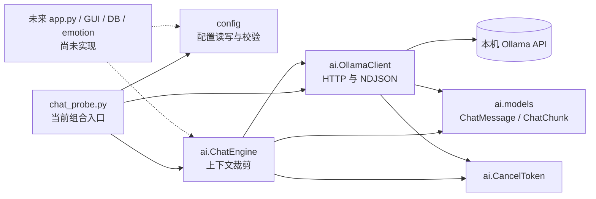
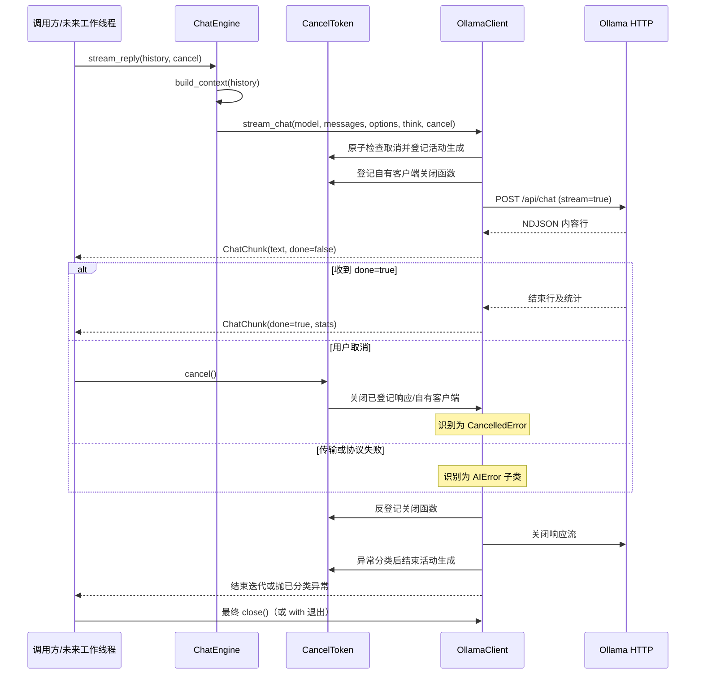

# Stage 2 AI 核心交付检查

原交付检查与本次整改日期均为 2026-10-23。独立审查结论为 **CONDITIONAL PASS**；本报告现已同步
G1–G4 的整改成果，并保留原交付检查的历史结果。当前代码与后续阶段设计分别说明，本文不能替代独立复审或 GUI 验收。

完整整改范围、复现证据、最终测试总数与提交记录见 [Stage 2 整改交付总结](STAGE2_REMEDIATION.md)。
本次未改变公开 API，未实现 Stage 3、GUI、数据库或情绪系统；Stage 3 仍须等待独立复审和用户确认。

## 1. 当前项目架构

当前可执行的主路径是 `scripts/chat_probe.py` → 配置层与 AI 层。`emowall/storage`、`emowall/emotion`、`emowall/gui` 目前只有包骨架；`emowall/app.py` 尚不存在。`docs/ARCHITECTURE.md` 中的 GUI、数据库线程和情绪流程是后续阶段设计，当前没有实现。

`ai` 与 `config` 均为叶子层，互不导入；AI 层仅使用标准库与 `httpx`，没有 Qt、SQLite 或 `asyncio`。`ChatEngine` 负责上下文和请求参数，`OllamaClient` 负责 Ollama 协议，调用方负责会话历史、生成器消费和资源关闭。

## 2. Stage 1 合并状态（2026-10-23 原交付检查记录）

- Git 分支为 `feature/stage2-ai-core`；Stage 1 提交 `6da908b` 是审查基线 Stage 2 提交 `0cccac2` 的祖先。检查开始时 `git status --short --branch` 无未提交修改，`git ls-files -u` 无冲突条目。
- `ConfigStore`、`AppSettings`、`OllamaSettings`、`ChatSettings` 均在当前树中。代码实现缺失文件时生成默认配置、读取和保存往返、损坏文件先备份再恢复、非法字段单独回退、未知字段保存时保留、同目录临时文件加 `os.replace` 原子替换。
- `tests/test_config.py` 与 `tests/test_ai_config.py` 验证上述行为、配置参数注入 AI、更新配置后创建新客户端、两层不互相导入。架构守护测试同时检查依赖方向。
- 原交付检查发现非法配置值曾直接写入 warning 日志。当时已把日志改为只记录字段名及回退动作，并增加不泄露输入值的回归测试；配置文件和公开接口未改变。本次 G1–G4 保留这些成果。

## 3. Stage 2 已实现功能

同步 Ollama `/api/version`、`/api/tags` 和 `/api/chat` 流式调用；NDJSON 增量解析与结束统计；按轮次和条数/字符预算裁剪上下文；跨线程取消令牌；连接、超时、HTTP、模型缺失、协议、断流、取消的异常分类；离线 MockTransport/假客户端测试与可选真实 Ollama 联调测试。

实现只支持一个 Ollama 提供者和文本消息。模型名称可通过创建新 `ChatEngine` 切换，但没有通用提供者协议、注册表或独立的多提供者配置。

## 4. 核心模块及职责

| 模块 | 当前职责 | 生命周期/边界 |
| --- | --- | --- |
| `emowall/config/{settings,store,paths}.py` | 默认值、校验、配置路径、JSON 读写与恢复 | 不导入 AI，不发网络请求 |
| `emowall/ai/models.py` | 不可变 `ChatMessage`、`ChatChunk`、`GenerationStats` | 文本角色限 system/user/assistant |
| `emowall/ai/engine.py` | 无状态历史裁剪、系统提示、调用 `stream_chat` | 历史由调用方按会话传入，不持久化 |
| `emowall/ai/client.py` | Ollama HTTP、NDJSON、状态码及异常映射 | 自建 `httpx.Client` 需显式 `close()` 或 `with`；注入客户端由注入者关闭 |
| `emowall/ai/cancel.py` | 跨线程取消标志、活动生成、资源登记及取消清理跟踪 | 旧生成、异常分类及清理结束前，`reset()` 主动抛 `RuntimeError` |
| `emowall/ai/errors.py` | `AIError` 异常层级 | 调用方可统一捕获基类或按子类处理 |
| `scripts/chat_probe.py` | 当前配置与 AI 的实际装配、多轮命令行探针 | 无 GUI/DB；脚本负责保存内存历史及关闭客户端 |

## 5. 主要调用流程

`ConfigStore.load()` 取得配置 → 入口映射配置字段并构造 `OllamaClient` 与 `ChatEngine` → 调用方把本会话历史及新用户消息传给 `stream_reply()` → `build_context()` 保留 system 和最新轮次，按预算裁去较旧轮次 → `OllamaClient.stream_chat()` 发出 Ollama 请求 → `ChatChunk` 逐块返回 → 调用方拼接完整或部分回复并决定是否写回历史。当前探针在正常结束后把回复加入内存历史；数据库持久化与 GUI 状态恢复尚无实现。

## 6. AI 请求生命周期与核心事件流程

生成器开始迭代才发请求；消费者提前停止时必须由消费线程显式关闭生成器，`ChatEngine.stream_reply()` 同样适用。
正常、异常和取消路径均通过响应 `with` 块释放流；不能仅收到 `done` 块便省略生成器收尾。

**G1 已修复**：原实现的 `cancel()` 清空资源登记表，使旧生成仍活动时的 `reset()` 错误成功，
随后可能把取消误报为网络中断。当前取消保留登记，并用活动生成与取消清理状态保护复用；
即使资源已经反登记，异常分类结束前也不允许重置。安静 EOF、错误正文读取失败等取消路径均优先报告 `CancelledError`。

**G2 所有权约定**：默认底层 `httpx.Client` 由 `OllamaClient` 创建和关闭，取消关闭后下一请求自动重建；
显式关闭 `OllamaClient` 后不得继续使用。Stage 5 生产路径必须使用默认自有客户端，每个实例独占一路生成。
外部注入客户端由注入者创建、最终关闭，`OllamaClient.close()` 不关闭它；该模式用于测试或明确的外部生命周期管理。
注入模式在响应头之前没有可关闭的响应，**不保证及时取消**，须等请求返回、超时或外部管理者中断；
收到响应后会关闭响应，但时延仍依赖传输。本次记录了这一限制，没有修复注入模式的底层取消能力。

自有模式的真实响应头前取消已由 G3 在本机验证；TCP/TLS 建连尚未完成时仍不承诺统一取消时限。
原交付的约 0.5 s 冷启动探针属于历史记录，不能推广为全部模式和环境的 500 ms 保证。
完整契约见 [ADR-0002](adr/0002-ai-core-boundaries-and-cancellation.md) 与 [架构 §5.2](ARCHITECTURE.md#52-stage-5-ai-工作线程契约未来实现)。

目前流式 API 只有**内容**和**结束**两种 `ChatChunk` 形态。开始、错误、取消通过调用开始和异常表达，没有独立事件对象或订阅机制；未来 GUI 需由工作线程把块和异常映射成 UI 信号，尚未验证。

## 7. 关键接口

| 接口 | 用途与约定 |
| --- | --- |
| `ConfigStore.load() -> AppSettings` / `save(settings) -> None` | 加载兼容配置、原子保存；单实例不是并发配置事务 |
| `ChatEngine.build_context(history) -> list[ChatMessage]` | 不修改原历史；system 与最新轮次为硬底线 |
| `ChatEngine.stream_reply(history, *, cancel=None) -> Iterator[ChatChunk]` | 同步阻塞生成器；调用方传入本会话历史 |
| `OllamaClient.stream_chat(*, model, messages, options=None, think=False, cancel=None)` | Ollama 传输入口，返回增量块及 done 块 |
| `CancelToken.cancel()` / `raise_if_cancelled()` | 跨线程发起取消及识别取消状态 |
| `CancelToken.reset()` | 活动生成、资源登记或取消清理未结束时拒绝复用；旧生成完全收尾后才能清除取消状态 |
| `OllamaClient.close()` / 上下文管理器 | 关闭自有 HTTP 客户端；注入客户端由注入者关闭 |
| `AIError` 子类 | 连接、超时、HTTP（含状态码）、模型缺失、协议、断流、取消分类 |

HTTP 401 等认证错误目前归入 `OllamaHTTPError(status_code=401)`，没有认证专属异常。模型切换只换 `ChatEngine(model=...)`；切换提供者仍需新增适配器并修改当前具体类型依赖。

## 8. 已运行测试与结果

### 8.1 2026-10-23 原交付检查历史（整改前）

下表保留原报告证据，其中“最终”仅指原交付检查结束时，不是 G1–G4 整改后的最终统计。

| 命令/检查 | 原交付检查实际结果 | 说明 |
| --- | --- | --- |
| `.venv\Scripts\python.exe -m pytest`（沙箱内首次） | **1 failed, 210 passed, 1 skipped, 8 deselected** | `test_http_json_rejects_non_json_payload` 本机回环连接遭 Windows `WinError 10013`；没有把失败当作通过 |
| 同一命令（允许本机回环连接后，日志修复与新增测试完成后） | **215 passed, 1 skipped, 8 deselected** | 最终完整默认测试通过；初次成功重跑为 211 passed、1 skipped、8 deselected |
| `.venv\Scripts\python.exe -m pytest -m "not integration and not local_network"` | **213 passed, 1 skipped, 10 deselected** | 沙箱内无真实 socket 的最终离线子集 |
| `.venv\Scripts\python.exe -m pytest -m integration` | **1 passed, 7 skipped, 216 deselected** | 当时 Ollama 服务不可用；1 项无需服务，7 项由测试夹具跳过。阶段规划记录的历史 `8 passed` 未在原交付检查复现 |
| `git merge-base --is-ancestor 6da908b HEAD` | 退出码 0 | Stage 1 提交确在当前 Stage 2 分支历史中 |
| `git ls-files -u` / 初始 `git status` | 无输出/干净 | 开始检查时无冲突、无未提交修改 |

当时的覆盖点包括配置往返与兼容、非法配置值日志保护、60 条历史裁剪、流式分块与 done、取消及后续请求、连接与读取超时、401/403/404/500、断流、协议错误、响应关闭、Qt 导入守护。`tests/conftest.py` 默认拦截真实 socket，`local_network` 与 `integration` 标记除外。

### 8.2 2026-10-23 G3 整改检查点（提交 `ea9df21`）

| 命令/检查 | G3 实际结果 | 说明 |
| --- | --- | --- |
| `.venv\Scripts\python.exe -m pytest` | **232 passed, 1 skipped, 10 deselected** | 默认测试包含两项本机回环网络测试；唯一 skip 为未安装 PySide6 |
| `.venv\Scripts\python.exe -m pytest -m "not integration and not local_network"` | **230 passed, 1 skipped, 12 deselected** | 严格离线子集，无真实 socket 连接；同一 PySide6 skip |
| `.venv\Scripts\python.exe -m pytest -m integration` | **10 passed, 0 skipped, 233 deselected，9.55 s** | Ollama 0.40.6、`qwen3:8b`，真实默认 HTTP 传输；无需网络的客户端关闭测试已迁回离线组 |
| 首次执行新增集成用例 | **1 failed, 9 passed** | 测试错误解包 `_http_json` 返回值；保留失败记录，修正后重跑 10 passed；最终版本再次运行结果如上 |

这些是 G3 完成时的历史检查点。G4 文档和一致性测试会影响收集数量，最终完整命令与总数统一以
[整改交付总结](STAGE2_REMEDIATION.md) 为准。skipped 从未计为 passed；本次真实 Ollama 无跳过。

G4 最终结果：默认 **244 passed / 1 skipped / 10 deselected**，严格离线 **242 passed / 1 skipped / 12 deselected**，
真实 integration **10 passed / 0 skipped / 245 deselected（8.27 s）**；最终冷启动取消 **0.000438 s**。
DeepSeek 续接后独立重跑：默认 **244/1/10**、严格离线 **242/1/12**、真实 integration **10/0/245（11.42 s / 8.96 s）**，
冷启动取消 **0.000431 s / 0.000651 s**（两轮）；证据与命令见整改总结 §11。
以下细节保留 G3 检查点测量，最终测量及全部命令见同一整改总结。

真实取消与资源证据：

- 冷启动前 `/api/ps` 无驻留模型，确认无其他模型任务后执行；测试本身不卸载模型。
  在真实 HTTP 等待响应头阶段取消，零内容块，原始 `ReadError` 正确分类为 `CancelledError`。
- 从发起取消计时，消费线程完成清理耗时 **0.0003872 s**；取消返回和线程完成两者较晚值为
  **0.0004907 s**，通过原定 **1 s** 目标，没有提高阈值或缩短读取超时。
- 连续三轮读流取消耗时分别为 **0.0004054 / 0.0004396 / 0.0004031 s**，每轮随后真实请求恢复成功，
  验证底层自有客户端重建。
- 取消后旧客户端、响应、保存的旧连接均关闭，连接池和请求队列为空；恢复后仅允许正常空闲 keep-alive。
  真实生成器提前关闭也释放响应并可继续请求；最终客户端退出后无活动连接或遗留请求。
  Ollama 模型继续驻留属于服务端正常行为，不是 HTTP 资源泄漏。

本次测量仅证明本机、当前依赖与测试场景；不等同于所有环境的时延保证或 GUI 完整验收。

## 9. 已知问题

1. **扩展契约未统一**：`ChatEngine` 构造参数标注为具体 `OllamaClient`；其他提供者可模拟 `stream_chat`，但尚无显式 `Protocol`/提供者接口，错误类型也带 Ollama 命名。独立多提供者配置未实现。
2. **事件种类不足**：`ChatChunk` 仅有文本、done、统计。开始、错误、取消不是流事件；工具调用、思考内容、音视频块也没有表示。订阅与 UI 信号转换未实现。
3. **上下文预算是近似值**：只按字符与消息数裁剪；system 和最新轮次即使超预算也保留，因此可能超过模型真实 token 窗口。历史归属和保存由调用方负责。
4. **单路生成约束**：同一自有客户端被取消时会关闭底层 `httpx.Client`；若并发复用，可能影响其他请求。
   G1 已由核心主动保护 `reset()` 生命周期，调用方仍须串行使用客户端，不得让下一轮与旧请求重叠。
5. **注入模式取消限制**：响应头之前无法由核心关闭整个外部客户端，不保证及时取消；未来生产工作线程必须使用自有独占模式。
6. **后续阶段尚未实现**：原交付真实 Ollama 7 项跳过的缺口已由 G3 真实 10 项通过关闭。
   GUI、部分回复持久化和取消后的输入恢复仍无代码可测，属于后续阶段任务。

## 10. 尚未验证的风险

- 本机冷启动、响应头前取消、读块取消已经 G3 实测；其他系统、依赖版本、网络及 TCP/TLS 建连阶段的时延仍需各自验证。
  注入模式的响应头前取消限制已明确，不能把默认自有模式结果外推到注入模式。
- G3 已验证三轮连续取消恢复与连接释放，尚未做长时间压力测试。消费者仍必须消费完或显式关闭生成器；遗漏关闭的资源占用不由垃圾回收时机提供保证。
- 同时发起多个会话请求或切换配置时的并发状态与会话隔离；当前单路、调用方传历史的模型没有会话 ID。
- 401/403、限流、云服务错误格式和服务端返回超大错误正文在真实提供者上的分类与隐私表现。
- 当前日志已避免记录非法配置值；其他异常文本、URL 中的用户信息及未来鉴权字段仍需专项安全审查。

## 11. 未来扩展点（本次未实现）

| 能力 | 预计修改边界 |
| --- | --- |
| Ollama 本地模型 | 现有客户端和配置可用；模型名由新 `ChatEngine` 注入 |
| OpenAI 兼容 API、其他云模型 | 新增传输适配器、认证配置、提供者选择及统一错误映射；明确提供者接口后再接入 |
| 工具调用、多 Agent 协作 | 扩充消息角色/内容与事件结构，引入工具或任务编排层；现有纯文本块不够 |
| 长期记忆 | 在组合根/未来存储层检索并组装会话历史，维持 AI 层不直接访问数据库 |
| 情绪系统 | 未来由调用方消费回复文本并调用独立 `emotion` 层 |
| 多模态输入、语音交互 | 扩充内容类型与流事件；音频设备、编码和线程生命周期放在 AI 传输层之外 |

## 12. 建议独立审查的重点

1. 复核 G1 的原始失败证据和生命周期测试，确认取消后立即 reset、异常分类前 reset、安静 EOF 等路径受保护；
   对照 G3 的真实 10 项通过记录、严格 1 s 冷启动目标及资源释放断言，不把历史 skipped 当成通过。
2. 对照未来 GUI 工作线程验证：取消后不再追加 UI、部分内容入库、输入恢复、DB 错误不阻塞生成。当前只是架构契约。
3. 核对自有与注入客户端的所有权、响应头前取消边界，以及 Stage 5 自有独占单路契约。
   多提供者接口仍属于未来设计，不应借本次整改实现注册表或 DI 容器。
4. 审查并发复用同一客户端、取消令牌重置、生成器提前终止与退出清理的竞争条件。
5. 用目标模型 token 统计验证默认上下文预算，并制定超预算最新轮次的处理策略。

**结论**：G1 取消令牌竞态已修复，G2 所有权与实际取消边界已明确，G3 本机真实联调与资源释放验收已通过，
G4 文档已同步并经 DeepSeek 续接复验。
Stage 1、Stage 2 已有功能和公开 API 保持；最终整改证据见 [整改交付总结](STAGE2_REMEDIATION.md)。
Stage 3 是否准入仍由独立复审和用户确认决定，本次到整改交付结束，不自行推进下一阶段。
